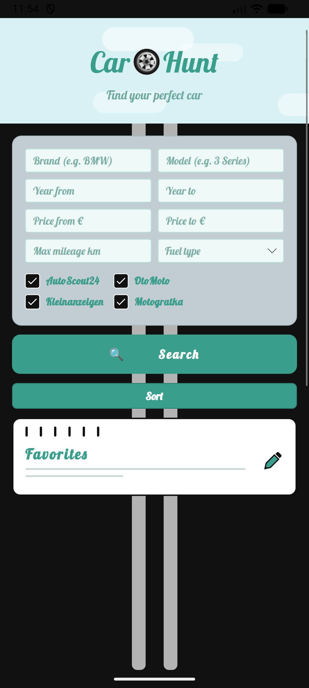
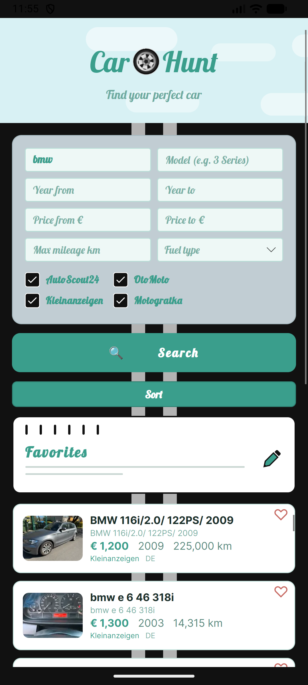
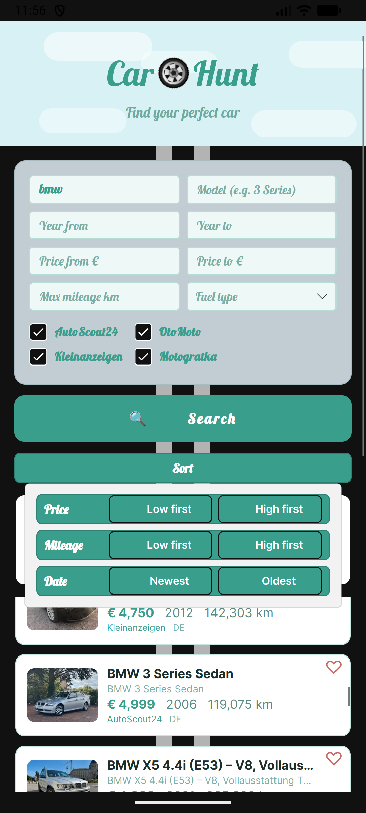
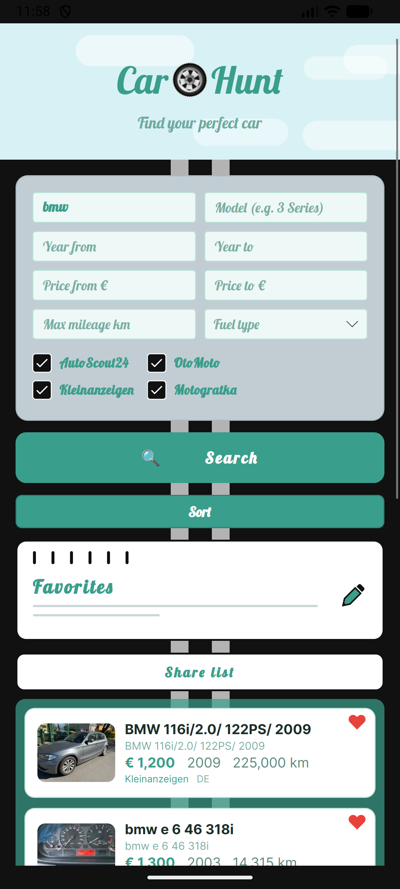

# CarHunt

Used-car search across four marketplaces at once: one query, results from all sites in a single list, prices converted to EUR.

Android app built with **Avalonia 12** on **.NET 10**. There is no backend: listings are fetched and parsed directly from the websites, favourites are stored locally in SQLite.

<p>
  
  
  
  
</p>

## Sources

| Marketplace | Country |
|---|---|
| AutoScout24 | Germany |
| Kleinanzeigen | Germany |
| OtoMoto | Poland |
| Motogratka | Poland |

## What it does

- Builds one search (make, model, price, year, mileage, fuel, gearbox…) and sends it to all four sites in parallel.
- Parses each site's HTML with AngleSharp and maps it to one `Car` model.
- Pages through up to 40 result pages per site, checks every listing against the filters and sorts the results.
- Converts prices to EUR and translates listing titles.
- Saves favourites in a local SQLite database.

## Tech stack

C# · .NET 10 · Avalonia 12 · MVVM (CommunityToolkit.Mvvm) · AngleSharp · sqlite-net-pcl · AsyncImageLoader · async/await with cancellation · Google Mobile Ads (Android only)

Projects: `CarHunt` (shared code), `CarHunt.Android` (main target), `CarHunt.Desktop`, `CarHunt.iOS`, `CarHunt.Browser`.

## Build

```bash
# check that everything compiles
dotnet build CarHunt/CarHunt.csproj -c Debug

# APK for an emulator
dotnet build CarHunt.Android/CarHunt.Android.csproj -c Release -p:AndroidPackageFormat=apk
```

## Notes

- Ad unit IDs in this repository are Google's public **test IDs**, so a build from source only shows test ads.
- No signing keys or credentials are stored in the repository; `.gitignore` excludes `*.keystore` and `*.jks`.
